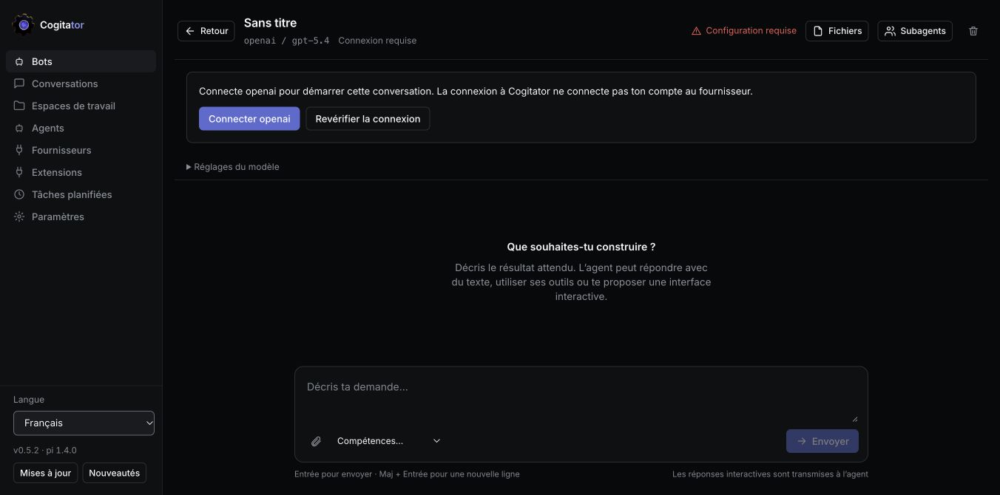
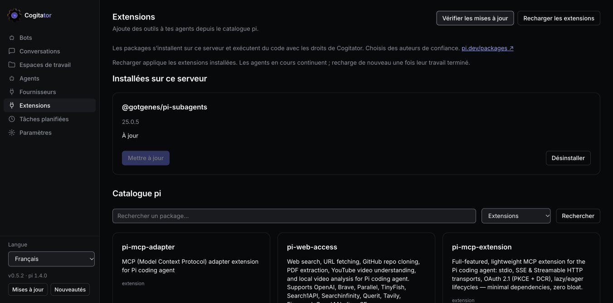
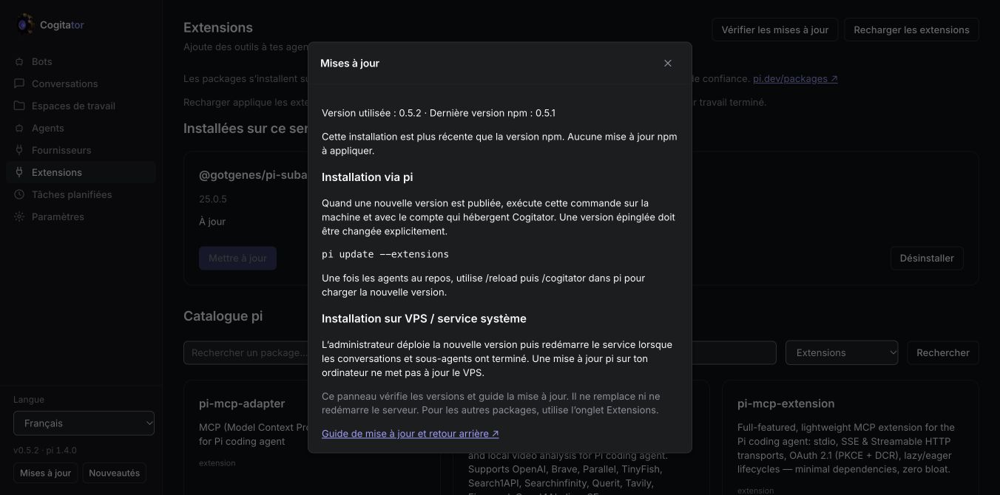

<div align="center">


# Cogitator

**Your pi agents, in a browser. On your computer or your own VPS.**

[](https://www.npmjs.com/package/@ignitionai/cogitator)
[](https://pi.dev/packages/@ignitionai/cogitator)
[](https://github.com/IgnitionAI/cogitator)

[Getting started](#get-started) · [User guide](https://github.com/IgnitionAI/cogitator/blob/dev/docs/user-guide.md) · [Guide français](https://github.com/IgnitionAI/cogitator/blob/dev/docs/guide-fr.md) · [VPS deployment](https://github.com/IgnitionAI/cogitator/blob/dev/docs/vps.md) · [Changelog](https://github.com/IgnitionAI/cogitator/blob/dev/CHANGELOG.md)
</div>

Cogitator is a **pi package and web UI**, not a separate hosted AI service. Connect your model providers, open a bot, and work through conversations, projects, skills and subagents. Your installation keeps its own data and credentials. The interface is available in **English and French**, including on mobile.

> **Release status:** this README describes the current `dev` build, including the upcoming **0.5.2** features. The published npm version is shown in the badge above. Features marked in the [unreleased changelog](https://github.com/IgnitionAI/cogitator/blob/dev/CHANGELOG.md) require the current source build until publication. Updating from npm does not install unreleased code.



## Get started

Install **Node.js 22.19.0 or newer** and [pi](https://pi.dev). Then:

```sh
pi install npm:@ignitionai/cogitator
pi
```

Inside pi, type:

```text
/cogitator
```

Cogitator opens in your browser at `http://127.0.0.1:5320`. The command starts the server in the background if necessary; simply installing the package does not start anything. Closing pi leaves the server running, including scheduled tasks. If pi was already open when you installed Cogitator, run `/reload` first.

1. Open **Providers** and connect the provider you want to use. Cogitator login and provider login are separate.
2. Open **Bots → Majordome → Talk**. Choose an available model if your provider has no access to the initial default.
3. Ask for something concrete: “Create a code-review agent for this project. Show me its settings before using it.”
4. Open **Workspaces** to import a GitHub repository or register a server folder.
5. Add optional tools through **Extensions**, then reload them.

You can also run `npx @ignitionai/cogitator` in the foreground. Ctrl+C then stops that server. For source development: `npm ci`, `npm run build`, `node dist/src/cli.js`.

## Meet your team

| Bot | What it does | Try asking |
| --- | --- | --- |
| **Majordome** | Operates Cogitator through its built-in MCP tools: agents, workspaces, conversations and schedules. | “Inspect my project and propose its initial setup.” |
| **Chef de Projet / Project Manager** | Plans work through GitHub Issues, tracks priorities and dependencies, assigns work to agents. | “Read the board, identify blockers and propose the next three tasks.” |
| **Architecte de Skills / Skills Architect** | Creates reusable `SKILL.md` procedures with references and validation. | “Create a skill for reviewing API changes, with an example and acceptance criteria.” |

These are editable agent presets, not separate subscriptions. Select their provider, model, reasoning level, instructions, skills and MCP servers in **Agents**. The Project Manager can use additional workflow skills when they are installed; those third-party skills are not bundled automatically. See the [working guide](https://github.com/IgnitionAI/cogitator/blob/dev/docs/user-guide.md).

## Work with pi in clicks

- **Conversations:** streaming responses, tool results, code, images, files and diffs. Change the model without discarding history once the current turn finishes.
- **Projects:** import GitHub repositories, connect a private GitHub account, inspect project files, use a GitHub Issues board and start agent work from a ticket.
- **Subagents:** install `@gotgenes/pi-subagents` from Extensions to enable delegation. Click a child in the Subagents panel to read its conversation in a large dialog, with live progress and expandable tools. The parent keeps working.
- **Extensions:** browse the pi catalog, install packages, check their versions, update individually and reload idle conversations. Active parents and background children keep running.
- **Skills:** import reusable procedures, attach them to agents or invoke `/skill:name` in a message. Ask the Skills Architect to create a missing procedure.
- **Schedules:** repeat a task with cron, inspect run history and review its outcome. The server must remain running; model usage is billed by your provider.
- **MCP:** the bundled stdio MCP server lets agents operate Cogitator. Agent presets can also use other MCP servers; **Settings** exposes global MCP configuration.



## Your VPS, your owner login

The current build supports a **single-owner installation on a remote Unix VPS**, behind HTTPS, protected by **email and password**. The email is the username/login identifier; no mail service is required. MFA is optional. Each person installs their own Cogitator: there is no public signup or shared multi-user service.

The server stays bound to `127.0.0.1`; Caddy or another trusted reverse proxy terminates HTTPS. Initialize authentication offline, then require it at every startup:

```sh
cogitator auth init --origin https://cogitator.example.org --email owner@example.org
cogitator --auth-required
```

Use an auth-capable build and the same dedicated OS account/data directory for both commands. Password entry is interactive and hidden. Do not proxy an unprotected default local instance to the internet.

Follow the [VPS guide](https://github.com/IgnitionAI/cogitator/blob/dev/docs/vps.md) for source installation, systemd, HTTPS, directories, health checks, maintenance and rollback. Native login protects browser access; agents still run with the server account’s permissions. Worker isolation, automatic recovery and backup/restore qualification remain separate work—not a promise of a sandboxed multi-tenant service.

## Updates and what’s new

The sidebar footer groups **Language → running version → Updates → What’s new**.

**Updates** checks the running Cogitator version against npm and shows the appropriate update instructions. It distinguishes a newer development deployment from the published npm release; it never suggests a downgrade. **What’s new** gives a short overview, with a link to the full changelog.



For a pi installation, when a newer release is published:

```sh
pi update --extensions
```

Wait for active agents to finish, then run `/reload` and `/cogitator` inside pi. An explicitly pinned source must be changed to the desired version. `/cogitator` can restart an older server only after verifying its process identity; it will not terminate an unrelated listener.

For a **systemd/VPS deployment**, update the server’s release and restart its service after work finishes; a laptop’s pi update does not deploy the VPS. See [updating and rollback](https://github.com/IgnitionAI/cogitator/blob/dev/docs/vps.md#updating-and-rollback). The footer currently **checks and guides**; it does not self-install or restart Cogitator. The separate Extensions screen does install/update pi packages.

## Data and troubleshooting

Default application data is in `~/.cogitator`; provider credentials, installed packages and conversation journals use the configured pi profile. On a VPS these are **server directories**, not your laptop’s files. `COGITATOR_HOME` and `COGITATOR_PI_AGENT_DIR` select explicit homes. Uninstalling the pi package does not delete your application data.

| Symptom | What to check |
| --- | --- |
| Provider connection appears stuck | Complete the provider’s device/browser flow. For a remote OAuth callback, follow the return-URL instructions in Cogitator; `127.0.0.1` in your laptop browser is not the VPS. |
| Unsupported model | Select a model supported by the connected provider, then apply it. A saved credential alone is not proof that every model is available. |
| No subagent tools | Install the subagent extension in the server’s pi profile and reload after active work finishes. |
| Private clone fails | Connect GitHub in Workspaces; check organization/SSO access and that `gh` is installed on the server. |
| Workspace outside enrolled roots | Configure the dedicated project root for the server. See the VPS guide. |
| UI shows old code after deployment | Refresh the browser. Reconnecting a conversation does not replace the loaded web bundle. |
| Wrong password / lost MFA | Use offline owner recovery with the server stopped. There is no email password reset. |

## Architecture and development

```text
Browser → REST + SSE → Node controller → pi RPC conversations and subagents
                          ↕
                SQLite + native pi files
Agents → bundled stdio MCP → Cogitator operations
```

Node is the supported runtime; Bun cannot currently replace it for this application's `better-sqlite3` usage. The repository uses TypeScript, React and a regression suite (`npm test`, `npm run build`). See [architecture](https://github.com/IgnitionAI/cogitator/tree/dev/docs/architecture), [authentication](https://github.com/IgnitionAI/cogitator/blob/dev/docs/native-auth.md), [interactive responses](https://github.com/IgnitionAI/cogitator/blob/dev/docs/chat-generative-ui.md), and [deployment evidence](https://github.com/IgnitionAI/cogitator/blob/dev/docs/firetower-readiness.md).

## License

MIT — © Salim Laimeche
