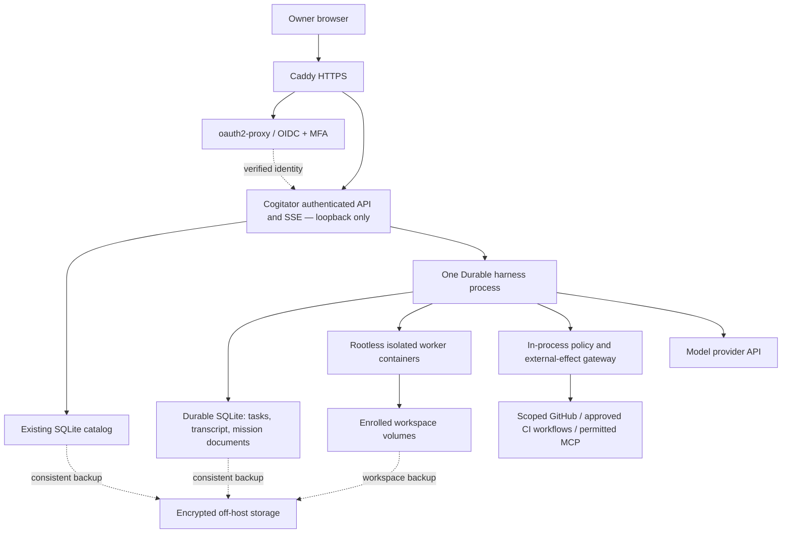
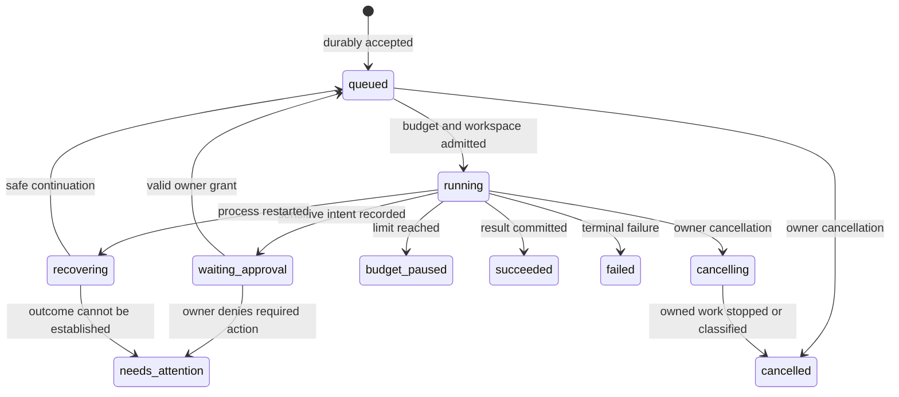

# Plan 0002 — Personal HTTPS access and durable VPS execution

Status: review-approved design (APPROVED); isolated P0 tooling implemented, P1–P5 not implemented. Full one-shot delivery is not verified or deployed.
Date: 2026-10-09
Design-research baseline: Cogitator 0.2.1, commit `65a5393`.
Execution baseline: Cogitator 0.3.0, commit `bd128d2b7225da6b465ffbb9267f4b4571c0c777`; preserve the independently delivered French/English UI and its tests.
Owner-confirmed requirements: public HTTPS access for one owner, authenticated from any browser; autonomous recovery; two concurrent jobs; development autonomy but approval for sensitive operations. The owner requested a one-shot plan, with remaining choices resolved conservatively.

## 1. Understanding lock and scope

- One owner, no registration, teams, tenant model, or billing product.
- Closing the browser or logging out does not cancel authorized work.
- After a process crash or ordinary VPS reboot, accepted work resumes from durable state, provided persistent storage is intact.
- Agents may read assigned projects, edit code, run tests, prepare branches, and open PRs in disposable mission-owned clones/scratch. Deleting or overwriting files inside that disposable scope is ordinary development. Production, infrastructure, credential changes, remote destructive actions, and destruction of owner-maintained data require explicit, narrowly scoped authorization; enrolling a project does not make its original directory disposable.
- Authorization survives restart, but remains revocable and bound to the exact operation. A generated chat form or an agent's statement is never authorization.
- No claim of uninterrupted availability, exactly-once external effects, unlimited memory, or automatic recovery from lost storage.
- Preserve the existing French/English UI and English documentation (the bilingual UI was delivered independently after the initial design). No general visual redesign, Kubernetes, Redis, distributed scheduler, or multi-region service.

### Proposed operating defaults

These are design defaults, not measured capacity or permission to spend money.

| Concern | Initial choice / acceptance target |
| --- | --- |
| Parallelism | Two active missions globally; one writer per workspace; queued work is durable |
| Host sizing | Start capacity validation around 4 vCPU / 8 GiB RAM; do not purchase or assume an existing VPS is suitable without measuring two representative jobs |
| Worker limits | Initially 2 GiB RAM, 1.5 CPU, 256 processes per worker; resource-limit failures become visible, not retry storms |
| Responsiveness | With two test workloads, non-streaming UI/API reads should stay below 500 ms p95, excluding identity-provider/network latency; verify on the chosen host |
| Process recovery | Target readiness and interrupted-work classification within 60 seconds of service restart; do not promise model completion within that window |
| Backup | Nightly encrypted off-host backup, seven daily and four weekly copies; target RPO 24 hours and restore within two hours, demonstrated before release |
| Disk admission | Stop new admissions below the greater of 5 GiB or 20% free space; record enforceable aggregate worker/storage limits and controller reserve on the actual host before release |
| Model budget | Initial estimated ceiling USD 5 per mission and USD 20 per UTC day; 64 model requests per mission, at most three transient retries per failed step, four hours of active execution excluding waits |
| Maintenance | Owner-operated; pinned runtime, extension, and image versions; deliberate upgrades with a rollback/restore procedure |

Reserve estimated request cost atomically before admission, count interrupted requests conservatively, and share limits across both workers and restarts. Refuse unknown pricing unless an explicit bounded token/request policy is configured. These are application estimates, not a provider billing guarantee; use provider-side spending controls where available. A mission cap (money, model-request count, retry count or active execution time) requires an explicit owner change to raise; no counter resets merely because the process restarted or the UTC date changed. When only the shared daily spend gate is binding, already accepted missions automatically re-enter the queue at the next UTC reset, subject to unchanged per-mission caps, valid policy/authorization and resource admission. The paused view names every binding limit and shows either the UTC resume time or the owner decision required. No automatic budget escalation.

## 2. Evidence and current gaps

Source inspection is not a production security audit or a crash-test result.

| Observed baseline | Evidence | Consequence |
| --- | --- | --- |
| Loopback-only HTTP, no application authentication | `src/cli.ts:50-54`, `src/server.ts:834-865`, current contract O4 | Do not expose port 5320 directly; authentication must cover REST and SSE, not merely React routes |
| No user/owner model | `src/db.ts:5-81` | A single configured owner is sufficient; no multi-user schema |
| Workspace registration accepts arbitrary existing directories; file reads lack realpath-based symlink confinement | `src/workspaces.ts:46-64,92-111`, `src/workspace-files.ts:77-106` | Remote workspace roots must be explicitly enrolled and file access confined |
| Provider listing redacts keys, but MCP/config snapshots can include secret-bearing configuration | `src/registry.ts:105-121,197-198`, `src/server.ts:282-288`, `src/conversations.ts:32-50` | Do not claim all current APIs are secret-safe; replace secret values with references/redacted views |
| RPC handles are in memory; JSONL session resume is on demand | `src/pool.ts:101-132,155-164`, `src/spawner.ts:35-42`, `src/history.ts:41-96` | Stored conversation history does not automatically resume interrupted execution |
| Cron runs inside the service; stale `running` rows are not reconciled | `src/cron.ts:159-174,192-220` | Restart behavior needs explicit proof |
| Due ticks skip execution when `catchup=false` | `src/cron.ts:196-208` | Reproduce with an isolated regression test; current historical/manual test reports do not prove ordinary scheduling |
| MCP and extension clients assume unauthenticated local endpoints | `src/mcp-server.ts:18-23`, `extensions/index.ts:15-18` | Introduce scoped internal callers; do not break local mode or silently bypass remote authentication |

Pi Durable is a separate experimental SDK, not a flag for `pi --mode rpc`. Its `watchEvents()` adapter does not establish RPC protocol compatibility. Skills/AGENTS.md reuse is demonstrated; automatic reuse of existing pi extensions, MCP configuration, and herdr is not established.

## 3. Options and selected direction

| Option | Advantages | Why selected or rejected |
| --- | --- | --- |
| Current RPC runtime on a supervised VPS | Smallest deployment change; preserves current integrations | Insufficient for the approved automatic checkpoint recovery requirement; retained for local/legacy sessions only |
| Whole-product replacement with Durable | One runtime eventually | Rejected for the first release: experimental APIs and unverified integration parity make a big-bang migration unsafe |
| Add a bounded Durable runtime for new remote missions | Meets recovery goal while keeping existing local sessions readable and functional | **Selected**, subject to the compatibility and security gates below; no fallback from failed Durable recovery to a classic RPC execution |

Access: select Caddy for HTTPS and oauth2-proxy with an external OIDC provider that supports MFA. Reject a homemade password/reset database and an all-new authentication framework. A managed access gateway is a valid later operational substitution, but is not required by this plan. The issuer, client ID, exact owner identity, DNS name, VPS, and backup destination are provisioning inputs, not invitations to weaken authentication when unavailable.

Execution: retain Node/TypeScript, the current React application, and REST/SSE. Use Pi Durable as the scheduler/checkpoint engine, not a new homegrown workflow engine. Use rootless container workers because arbitrary development commands must not run in the credential-owning control process.

## 4. Target boundaries

### Access boundary

- Public ingress is HTTPS only; no direct access to Cogitator, OAuth proxy, SQLite, worker endpoints, or daemon sockets. Preserve loopback binding. Restrict SSH separately; never expose the Docker API.
- Require the configured owner identity, not merely membership of an email domain. Pin verified issuer, audience and stable subject; validate signature and expiration using a maintained JWT/OIDC library. The gateway strips client-supplied identity headers and forwards a verified identity token; the application validates it rather than trusting arbitrary `X-Forwarded-*` values. Demonstrate the exact token/header mapping in the access spike; opaque access tokens are not ID tokens.
- Require an enforced MFA policy for this owner/application, not merely an MFA-capable issuer. Establish enforcement through the provider's application/account policy and appropriate verified authentication claims where available; reject a fresh password-only login in P1. If enforcement cannot be established, provisioning fails.
- Fail closed if identity configuration is missing, invalid, or unverifiable. Keep previously verified keys cached only according to a bounded policy; never disable verification during IdP failure.
- Secure, HttpOnly, SameSite session cookies; short refresh/revalidation; bounded sessions. No bearer tokens in URLs or browser localStorage, and no secrets or auth headers in logs.
- Enforce the canonical Host/Origin and JSON Content-Type for browser mutations; reject cross-origin writes and permissive credentialed CORS. Protect login callbacks with the gateway's state/nonce mechanisms.
- Authenticate every REST/SSE entry point. Watching history or connecting SSE must not create a mission. SSE renews authorization by reconnecting at most every 60 seconds; logout closes browser streams, and operator revocation disables new access and existing streams within that bound. Logging out does not abort missions.
- The local classic mode remains loopback-only. A remote mode refuses startup without its access policy. Minimal health/readiness is local; infrastructure probes must not expose configuration.
- Internal automation uses distinct mission-scoped credentials and endpoint allowlists. Neither an agent nor a worker receives an owner browser session. Full administrative Cogitator MCP methods are unavailable to autonomous workers.

### Execution and secret boundary

- The controller runs under a dedicated non-root account. It owns provider credentials, runtime state, approval records and policy; workers cannot read or alter them.
- Use a rootless container daemon under a separate worker account, with access limited to that account's directories. Controller access to that daemon does not grant host root. No privileged containers, host networking, host PID namespace, rootful socket, or control-plane/state mounts.
- Each mission receives a disposable clone from an enrolled, recorded source revision and an immutable toolchain image; owner originals and input datasets are absent or read-only. Do not share writable Git metadata with the original repository. Export proposed changes through reviewed artifacts/branches, not writes to the owner's source directory. Use a read-only base filesystem, separate bounded scratch, dropped capabilities, and resource limits. Validate rootless resource enforcement on the target kernel; unsupported limits are a deployment failure, not a silent downgrade.
- Workers get no production secrets, broad GitHub token, provider keys, host home, SSH agent, or unrestricted control-plane MCP endpoint. External credentials remain in the trusted gateway and are scoped to the exact repository/action.
- Credentialed GitHub/CI operations use structured, allowlisted tools, not a generic authenticated HTTP proxy. Protect main/release branches and production environments. Do not grant workers permission to change CI workflow definitions or approvals. Verify enforcement with a deliberately denied push; documentation alone is not branch protection.
- Repository enrollment requires auditing branch/PR-triggered CI: agent-authored code and tests must run without production secrets, write-capable broad tokens or privileged/self-hosted runner access. Review `pull_request_target`, reusable workflows and workflow chaining; do not enable autonomous PR creation if those paths can escalate privilege. Trusted publication tools must not execute worker-supplied Git hooks, filters or credential helpers.
- Default-deny worker egress to host/control/private networks and cloud metadata. Allow only the package/network destinations required by the approved toolchain, through a controlled egress path. This reduces exposure; it does not prove that arbitrary project data cannot be exfiltrated through an allowed service. Highly sensitive workspaces need a stricter no-network profile and are not silently enrolled.
- Resolve real paths and reject symlink escapes on reads, writes, imports and workspace registration. Container mounts are the primary containment; path checks are defense in depth. Arbitrary host directory registration and host-side npm/npx imports are disabled in remote mode.
- Until a command, MCP server, or extension is classified and tested, it is unavailable to remote missions. Never load user-editable agent code into the credential-owning controller as an automatic compatibility shortcut.

## 5. Domain and state ownership

These are logical records, not finalized SDK interfaces or a new ORM schema. The compatibility spike must map them to the pinned Durable document/task API.

| Term | Meaning and source of truth |
| --- | --- |
| Conversation | Existing catalog identity with frozen `runtime_kind` (`classic` or `durable`) and runtime reference. Classic history stays in its existing pi JSONL files |
| Mission | One accepted autonomous request, identified by a stable request ID within its conversation; inputs, workspace, policy/version and budget are durable records |
| Task | Durable's checkpointed unit of execution; do not invent a parallel task scheduler |
| Approval grant | Owner decision for a canonical action digest, mission, target, ref/artifact digest, argument digest, expiry and allowed uses; durable and revocable |
| Effect receipt | Intent/idempotency key and observed remote outcome/reference for an externally visible operation; never infer success just from model text |
| Workspace claim | Exclusive write ownership while work can mutate one enrolled directory; different jobs queue rather than race on the same checkout |
| Runtime lease | OS-enforced exclusive ownership of the Durable storage by one process; unrelated to login and to workspace write ownership |

Durable owns mission state, task checkpoints, transcripts, approvals, external-effect intents/receipts and execution budgets. The existing SQLite catalog retains presets, workspace metadata and references. Do not duplicate transcripts or maintain two competing mission-status authorities. Cross-store projections must be idempotent and reconstructible from the authoritative runtime; do not pretend separate databases share a transaction.

The diagram is a UI projection of authoritative tasks/documents, not an independently mutable status column. Waiting or budget-paused work does not consume an execution slot. Existing writes must stop before a workspace claim is released; a still-running worker prevents reuse of its directory even if the model is idle.

### Recovery and external effects

1. Acquire the runtime lease before opening storage; a second instance exits without scheduling anything. A single supervised service owns both interactive and scheduled Durable work.
2. Load the pinned registry/policy, verify storage versions, reconcile known worker IDs and interrupted effects, then enable Durable scheduling/resume. Readiness remains false while ownership or state is uncertain.
3. Before an external effect, commit its canonical intent, stable idempotency key and applicable authorization. Perform it only through the policy gateway; record the remote result afterward.
4. On recovery, query the remote result or retry with the same idempotency key only when supported. If neither is safe, mark `needs_attention`; do not ask the model to guess whether to repeat a deployment.
5. Execute the exact immutable artifact, argument set and target covered by the grant. A mutable branch, working tree, script URL or dependency resolution is not an approved artifact; resolve and verify content before approval and reject a dispatch-time mismatch. A connector unable to pin/check those inputs remains disabled. Recheck approval scope, expiry, revocation and remaining uses immediately before every protected effect. Approval consumption and intent association must be atomic in the runtime. Persisted intent permits reconciliation of that same attempt, not a second authorization-free action.
6. `requestId` deduplicates resubmission only within the same conversation. A new ID is not inherently the same request. The UI persists its pending ID before sending and reuses it after reconnect/reload until receipt is known.
7. A crash can leave a worker command alive. Persist worker/execution identity before dispatch; on restart adopt/observe it or stop and classify it before launching replacement work. A shell command's replay safety must not be inferred from its name. Unclassifiable shell side effects require attention.
8. A shell test/code-writing job is not exactly-once. The recovered agent must inspect the workspace after an interrupted command; never relaunch an unknown detached process or external side effect blindly.

Minimum autonomous recovery is not satisfied by routing every failure to `needs_attention`. P0/P3 must demonstrate: an interrupted model response resumes; a recorded file edit in a disposable clone is reconciled against before/after content and completed or replanned within that clone; and an interrupted offline test/build in that clone is observed or terminated and then safely rerun without owner input. Only verified toolchain profiles with no external effects qualify for automatic test replay. Unknown external outcomes, conflicting protected inputs and unavailable authorization remain explicit attention cases.

### Owner decisions when automatic continuation is unsafe

Denial of a required protected action records a durable denial and moves the mission to `needs_attention` with reason `action_denied`; no effect runs and no identical approval is repeatedly requested. The owner may cancel, revise the mission to exclude that action, or explicitly reopen its authorization. An expired pending request remains `waiting_approval` with an expired label until renewed or cancelled; an expired grant cannot dispatch a new effect. Denial, expiry and cancellation are distinct events, not generic execution failures.

Every `needs_attention` case must show the specific uncertain operation/worker, known receipts/output and timestamps, what remains unknown, the concrete owner task, and the conditions for safe continuation. For example: verify a deployment using its external run ID, then reconcile that result through the connector; do not present a generic “Retry” button for an unknown outcome. Resolving an outcome and approving a new attempt are separate decisions. Approval is not evidence that an earlier attempt failed. If the connector cannot verify the outcome, preserve that uncertainty and require explicit manual reconciliation or cancellation; never relabel it as proven success/failure on model advice. Cancellation does not undo an already accepted external effect.

A stable registry and explicit compatibility checks are essential: changing the meaning of an in-flight tool/task under the same name is not a routine hot update. Drain or preserve compatible versions; never switch a conversation from Durable to RPC to make an error disappear.

## 6. Compatibility, storage and current contracts

- **I5 / ADR-006:** keep classic pi JSONL history untouched. Propose a narrowly scoped amendment allowing Durable-owned transcripts/documents in its own storage. Do not store the same transcript in the catalog. Amend the active contract only in the implementation change that establishes the new boundary.
- **I3:** retain the sole classic spawn path; add one explicit Durable runtime composition point. No feature may create an unmanaged process or harness.
- **O6:** freeze preset, policy, toolchain and extension versions per mission. Durable's ability to update prompt sections does not silently authorize changing a running mission's capabilities.
- **O4:** keep loopback binding; HTTPS terminates at the gateway.
- **I2 / O1 / ADR-005:** preserve local behavior. Define the remote execution-environment boundary and the explicit status of herdr compatibility before enabling it. Do not label a native Durable child conversation a herdr agent.
- **History:** pin `runtime_kind` at creation. Old sessions remain in classic mode; no automatic transcript conversion or assumption that Durable JSONL is pi-session JSONL. New remote missions use Durable only after its gates pass. Legacy classic execution must not become an unisolated remote backdoor; initial remote access to imported classic history is read-only.
- **MCP/skills:** reuse verified skill loaders; run tool-bearing stdio MCP servers in the worker boundary or expose a restricted trusted connector. Remote MCP identities/permissions must be reviewed. Block unsupported presets rather than silently dropping tools or granting more access.
- **UI:** adapt committed views/events to the shared chat surface. Use stable runtime entry identities and coherent snapshot/subscription boundaries; avoid reliance on text-overlap reconciliation for new Durable sessions. Preserve generative UI validation and the distinction between a form response and an approval.

Durable's documented SQLite defaults protect process-crash recovery, not necessarily the latest writes after power/host loss (`WAL`, `synchronous=NORMAL`). Select and verify `FULL` durability for this deployment if supported by the pinned adapter; otherwise explicitly reduce the hard-loss guarantee and block any stronger claim. Off-host backups remain necessary in either case.

## 7. API and user-experience delta

Keep existing conversation endpoints; add only the contracts required for remote missions. Final schemas belong in `docs/architecture/api-contract.md` during implementation, not as claims about today's server.

| Proposed surface | Contract |
| --- | --- |
| Owner login/logout | Gateway-owned OIDC flow; no Cogitator registration or password reset; deny any identity other than the configured owner |
| `POST /api/conversations/:id/messages` | Durable mode requires a bounded stable `requestId`; acknowledge only after durable acceptance; return the accepted submission identity. Queue by default while busy; explicit steer retains separate intent semantics |
| Existing history/events routes | Authenticated committed snapshot + updates; stable entry IDs; no mission start on a read; auth expiry and reconnection preserve pending input and form state |
| `GET /api/missions/:id` | Authoritative projected status, budget, current work, approval requirement and outcome; secrets redacted |
| `POST /api/missions/:id/approvals` | Owner-only decision about a server-created immutable pending action; no arbitrary client-supplied privilege or command to approve |
| `POST /api/missions/:id/approvals/:grantId/revoke` | Revoke future protected dispatches; cannot undo an effect already accepted by an external system |
| `POST /api/conversations/:id/stop` | Stop owned execution and classify uncertain effects; do not claim cancellation until running workers are stopped/observed. Support cancellation from queued/waiting/budget-paused states too |

All inputs are bounded and validated. Distinguish 401 (not authenticated), 403 (not allowed), 409 (state conflict), 429 (admission/rate limit), and 503 (runtime not ready). A rejected request must not create hidden work. An accepted request blocked by its execution budget remains visible as `budget_paused`, rather than a failed send inviting accidental duplication.

### Existing-screen behavior, not a visual redesign

| Surface | Required states and truthful behavior |
| --- | --- |
| Login | Sign in, unavailable identity provider, rejected account; never a permanent loading screen |
| Conversation | Queued, running, recovering, waiting for approval, paused by budget, needs attention, completed/failed/cancelled; explain what continues when the browser closes |
| Approval panel | Fixed operation, target, commit/artifact, consequence, validity and explicit approve/deny; separate from model-generated forms; keyboard/focus accessible |
| Recovery | Show confirmed state, retained output and unresolved effects; never show “completed” for an unrecorded result |
| Reconnection | Preserve pending request identity/draft, reconnect after login, and recover the committed view without duplicate sends |

Detailed visual mockups are deferred to the affected implementation slice; this plan reuses `DESIGN.md`, `web/src/chat.css` and existing native controls rather than creating a parallel design system. A fixture-driven review of every new state is a gate before shipping that slice.

## 8. Delivery plan and exit gates

Effort is an initial engineering estimate, not a commitment; deployment credentials and external approvals are excluded. Expect approximately 12–20 focused engineering days, revised after P0.

| Phase | Work and principal files | Exit gate | Estimate |
| --- | --- | --- | --- |
| **P0 — Prove the runtime seam** | Pin a Durable release; isolated harness/worker spike around `src/pool.ts`, `src/spawner.ts`, `src/history.ts`; test actual `requestId`, events, approvals/documents, tool policy, skill loader, one necessary MCP integration and storage version behavior | Crash during generation and a controlled tool; reopen/resume; prove no duplicate protected effect; explicit compatibility matrix for required presets. No public deployment and no full runtime rewrite | 2–3 days |
| **P1 — Establish the access boundary** | Gateway and systemd deployment spec; auth/Origin/Host boundary in `src/server.ts`; update `src/mcp-server.ts`, extension probes and UI auth-expiry handling; fail-closed remote configuration | External tests deny unauthenticated/wrong-owner REST, SSE, files and writes; forged headers/direct port access fail; valid owner works from a clean browser; logout/revocation bounded | 2–3 days |
| **P2 — Constrain execution** | Container-backed execution environment, workspace enrollment/path confinement, rootless daemon and egress policy, scoped external-effect tools; remote restrictions on skill import/MCP | Malicious fixture cannot read control secrets, mount host files, reach metadata/control ports, alter approvals, push protected refs or bypass an action grant through bash | 2–4 days |
| **P3 — Integrate durable missions** | Shared runtime selection/adaptation, durable documents and approvals, request IDs, two-slot admission, workspace claims, budgets, frozen runtime versions; chat snapshots/states | Process-kill matrix passes; pending messages/approvals/budgets survive; two browsers do not double-submit; no process leaks; classic local sessions remain functional | 3–4 days |
| **P4 — Reconcile scheduling and upgrades** | Reproduce/fix cron gaps in `src/cron.ts`; durable schedule occurrences use stable schedule/occurrence IDs; classify missed runs, stale claims and retained workers; migrate no old session implicitly | Normal schedule and catch-up differ correctly; same occurrence cannot execute twice after restart; real worker cancellation; rejected old runtime schemas fail safely | 1–2 days |
| **P5 — VPS acceptance and recovery** | Provisioned staging environment, coherent backup of catalog/runtime/workspaces/config references, alert delivery, capacity test, restore and rollback exercise | Off-host restore drill, reboot drill, authenticated mobile/desktop check and 24-hour controlled soak; no hidden retries or secret leakage; all release gates pass | 2–4 days |

P0 precedes commitment to the integration. P1 and P2 must both pass before any remote autonomous execution is exposed. Schedule the remaining work sequentially for one implementer; do not multiply infrastructure for parallelism. If compatibility or isolation fails, stop at the gate and report the unsupported capability; do not replace safety with a prompt instruction.

### Required fault and security matrix

- Browser reload/disconnect, expired login and duplicate POST with the same request ID.
- SIGKILL before acceptance, after durable acceptance, mid-model response, mid-tool, after remote success but before receipt, and after approval consumption.
- Restart with a still-running worker, expired/revoked approval, unknown tool version, full disk, unavailable provider, exhausted budget, or corrupt/unavailable storage.
- Second harness instance against the same state directory; two missions targeting one writable workspace.
- Forged identity headers, wrong owner, direct backend access, cross-origin writes, stream expiry, symlink escape and unrestricted import attempts.
- Sandbox attempting to read provider credentials, runtime DB, approval records, Docker socket, host/private addresses or cloud metadata.
- Unauthorized branch/CI/workflow/production actions attempted both through a tool and through a shell command.
- State restore on an isolated host with all outbound effects disabled first. A restore creates a new recovery epoch and invalidates restored approvals/automation credentials; it must not resurrect consumed or revoked authority. Receipts/intents created after the backup may be absent entirely: require owner-reviewed reconciliation with external systems and prohibit replay of work whose effect history cannot be established. Ordinary process restart is not a restore and retains valid grants. Re-enable dispatch only for reconciled missions with fresh required authorization; never claim that absent receipts can be recovered from the backup.

### Operations and rollback

Use one systemd-supervised controller process, with restart backoff and an exclusive storage lease. No clustered Node workers. A rootless daemon restart and retained containers must be part of the recovery drill. Emit structured, redacted logs keyed by mission/task/effect IDs; expose disk, queue, stale-recovery, budget and backup age indicators. Send external email alerts for needs-attention, prolonged recovery and backup failures; a dead VPS needs an external heartbeat monitor, not a self-reported “healthy” page.

P5 records measured disk allocations for controller state/WAL, clones, scratch, images, artifacts and logs. Enforce aggregate worker storage limits with supported host/storage quotas, retaining capacity for controller checkpoints and effect receipts; a free-space check alone is not a hard quota. Stop new admissions before the stated reserve threshold is crossed and safely pause/classify active work on storage pressure. If quotas/reserves cannot be enforced on the chosen host, do not enable autonomous remote execution. Default retention: rotated logs for 14 days within a 1 GiB cap; terminal disposable clones/artifacts for seven days only after their results are exported/backed up and no unresolved effect or active task refers to them; retain current, rollback and active-task images. Do not automatically delete authoritative transcripts, approvals or effect receipts in V1. Never prune active work or unresolved evidence to make room; alert and require an explicit retention/capacity decision instead.

Back up the runtime, catalog, workspace changes and necessary encrypted configuration as one documented recovery set. Quiesce new work and reach a verified backup boundary; use supported SQLite backup/checkpoint mechanisms, not a raw live `.db` copy that ignores WAL. Restore testing starts with dispatch disabled. Credentials needed for off-host recovery must not exist solely on the failed VPS.

Pin the registry and migrations with each release. Drain or explicitly classify active work before upgrade. Retain compatible images and a pre-upgrade backup. Roll back code only when the stored schema/task versions remain compatible; otherwise restore into an isolated environment and reconcile remote effects before enabling execution. Do not restore an old database over a live agent fleet or promise zero data loss from a backup rollback.

## 9. Decision and review log

| ID | Decision | Alternative rejected / reason |
| --- | --- | --- |
| D1 | Public HTTPS, exactly one owner, gateway OIDC plus backend identity enforcement | VPN-only conflicts with confirmed access requirement; homemade passwords add avoidable security maintenance |
| D2 | New Durable remote missions; preserve classic local sessions | Supervision alone does not satisfy checkpoint recovery; big-bang conversion risks incompatible histories/integrations |
| D3 | One owning process and explicit runtime/workspace locks | Multiple writers are unsupported; conversation ownership is not an access-control capability |
| D4 | Durable owns mission truth; catalog holds references | Dual transcript/status authorities create ambiguous recovery and non-atomic cross-store writes |
| D5 | Rootless isolated execution and scoped trusted effect tools | A login screen or prompt restriction cannot constrain arbitrary shell access to host credentials |
| D6 | Persist bounded grants and reconcile uncertain effects | “Exactly once” submissions do not guarantee exactly-once external actions; replaying a guessed outcome is unsafe |
| D7 | Two jobs, bounded resources and durable budgets | Unlimited retries/concurrency contradict personal VPS capacity and cost control |
| D8 | Measured backup/restore and pinned upgrades | A durable framework does not supply host-loss recovery, high availability, or schema-compatible rollback |

### Review resolutions

| Reviewer / objection | Disposition and resolution |
| --- | --- |
| Skeptic S1: MFA capability is not enforcement | Accepted: explicit enforced-policy evidence and a password-only negative test are required by the access boundary |
| Skeptic S2: PR CI can bypass protected-effect controls | Accepted: repository enrollment audits untrusted CI, workflow chains, secrets and runner privileges; unsafe PR automation stays disabled |
| Skeptic S3: approved refs may resolve to different bytes | Accepted: immutable artifact/argument/target matching is required at dispatch; incapable connectors stay disabled |
| Skeptic S4: restore resurrects grants and loses effect evidence | Accepted: a new restore epoch invalidates old authority; missing post-backup outcomes require owner reconciliation, not automatic replay |
| Skeptic S5: safe stopping could replace useful autonomy | Accepted: explicit autonomous model, local-edit and offline-test recovery demonstrations are mandatory |
| Skeptic S6: destructive actions include normal code edits | Accepted: autonomous mutation is confined to disposable clones; original repositories/data are read-only or absent |
| Constraint Guardian CG1: aggregate disk use can exhaust recovery storage | Accepted: measured host-wide allocations, enforceable quotas/reserve, admission threshold and bounded safe cleanup are mandatory; active work and unresolved evidence are never pruned |
| User Advocate UA1: denial/expiry outcomes are ambiguous | Accepted: durable denial stops the required action with a specific attention reason; no repeated identical requests; expiry remains visibly waiting and requires renewal/cancellation |
| User Advocate UA2: attention states lack a resolution contract | Accepted: every case shows evidence, uncertainty, owner task and continuation conditions; reconciliation and new authorization are separate decisions |
| User Advocate UA3: budget pause/reset behavior is unpredictable | Accepted: only the daily gate resets automatically at UTC; per-mission limits never reset implicitly, and the UI names the binding limit and next action |

Review disposition: **APPROVED — design only**, after sequential Skeptic, Constraint Guardian and User Advocate reviews and independent Arbiter review on 2026-10-09. The Arbiter accepted all ten recorded resolutions and found no remaining blocking contradiction with the confirmed requirements. No objections were silently dropped. This does not certify implementation, security, capacity or recovery; the phase gates remain mandatory. User confirmation covers the requirements; it is not permission to deploy or incur costs.

## 10. One-shot execution record

Tracking issue: [IgnitionAI/cogitator#7](https://github.com/IgnitionAI/cogitator/issues/7), created and read back as OPEN for this run.

The owner explicitly requested the entire P0–P5 scope through `analyze → plan → implement → code-review → verify`. This plan remains the implementation source of truth; a passing isolated P0 check is not completion of the entire request. GitHub tracking is required because the work spans multiple subsystems, deployment and external coordination.

Analysis established:
- Current code is 0.3.0 with independently committed bilingual UI work; preserve it and all existing uncommitted planning documents.
- `@earendil-works/pi-durable@1.1.0` is available and requires Node >=22.19.0. Pin this version for the isolated spike; record the exact resolved dependency graph rather than testing mutable upstream `main`.
- Local Docker is available, but is not demonstrated to be a production-equivalent rootless setup. It can support local experiments, not certify VPS isolation or quotas.
- No target VPS, public DNS name, OIDC application/owner identity, or off-host backup destination has been designated for this run. Configured SSH aliases alone do not authorize choosing or altering a host. No cloud purchase is authorized.

Implementation order and stop conditions:
1. Implement P0 as isolated tooling/tests against the real pinned SDK, not a homemade mock of its durability semantics. Use controlled provider/tool fixtures, temporary data and explicit subprocess crashes; no real model calls or external side effects. Keep it off the production execution path and out of the published runtime until compatibility is proven.
2. P0 must report exactly which approved gates are proven: submission deduplication, checkpoint/model recovery, edit/test recovery, unsafe-effect classification, persisted approval data, event adaptation, skill/MCP compatibility and supported storage versions. Unproven integration/isolation points remain blockers; do not declare the phase passed from a smaller happy-path test.
3. Continue P1–P5 only through their gates. Preparation that is independent of credentials is allowed, but a mock IdP, local Docker or generated config is not evidence of a deployed authenticated service.
4. Review implementation against this full plan and verify every acceptance criterion as PASS, FAIL or BLOCKED — NOT PROVEN. Missing target access/credentials is a material stop, not permission to expose the current server, invent identities or silently reduce scope.
5. Leave the tracking issue open until every criterion passes, including real VPS recovery/restore and the controlled soak. Do not publish a release or declare the deployment complete merely because local tests pass.

### Implementation checkpoint

The isolated SDK spike is implemented in `scripts/durable-spike/`, with exact SDK pins and its own lockfile; root runtime dependencies and the existing classic graph remain unchanged. [P0 evidence](../../../durable-spike.md) records the bounded supported profile and 15 actual SIGKILL/reopen scenarios, including revision-recorded disposable Git clones, a real offline Node test, grant rejection/binding and frozen-profile checks. Missing legacy/herdr support stays explicit rather than silently broadening capabilities.

P0's fixture-profile checks do not implement a remote backend or certify rootless containers, real OIDC/MFA, deployed recovery, arbitrary coding presets, or P1–P5. The first external gate remains designation of the authorized target VPS, hostname and configured OIDC owner/application. Those cannot safely be inferred from unrelated SSH aliases or model-provider credentials. Review and verification must continue to report the full request as BLOCKED — NOT PROVEN while these criteria remain unmet.

## 11. Primary references

- [Pi Durable introduction](https://earendil.com/posts/pi-durable/).
- [Durable README](https://github.com/earendil-works/pi/blob/main/packages/durable/README.md): experimental API, storage ownership, resume, submission IDs, execution environments.
- [Durable specification](https://github.com/earendil-works/pi/blob/main/packages/durable/docs/spec.md): effect boundaries, replay, ownership versus authorization.
- [Experimental coding-agent integration](https://github.com/earendil-works/pi/tree/main/packages/coding-agent/src/experimental/durable): reuse examples, not automatic support for the existing pi extension ecosystem.
- Existing [architecture contract](../../decisions/ARCHITECTURE_CONTRACT.md) and [ADR-008 proposal](../../decisions/ADR-008-secure-vps-durable.md).

Upstream `main` is mutable. P0 must record the exact package versions, source commit and conformance evidence used for implementation; this research snapshot is not a compatibility certification.
