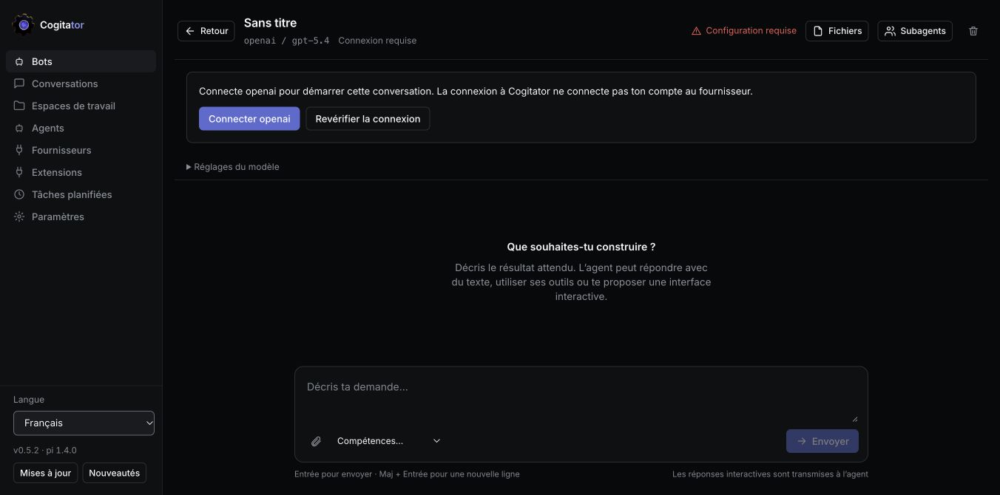
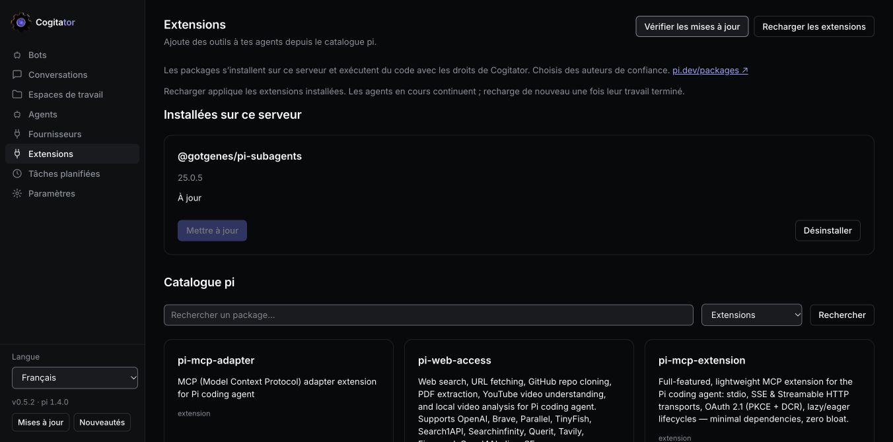
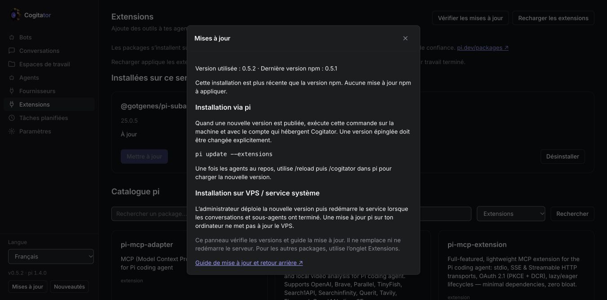

# Travailler avec Cogitator

[Accueil](../README.md) · [Guide détaillé en anglais](user-guide.md) · [Installation VPS](vps.md) · [Changelog](../CHANGELOG.md)

Cogitator est **l’interface web de tes agents pi**. Tu l’installes sur ton ordinateur ou sur ton propre VPS. Chacun possède son installation ; ce n’est pas un service avec inscription publique. L’interface est disponible en français et en anglais.

> Cette documentation décrit le code actuel de `dev`. Les nouveautés 0.5.2 ne sont pas encore toutes publiées sur npm : consulte le badge de version et le changelog avant d’installer.



## Démarrer

Avec Node.js ≥ 22.19.0 et [pi](https://pi.dev) installés :

```sh
pi install npm:@ignitionai/cogitator
pi
```

Dans pi, lance `/cogitator` : le serveur démarre au besoin et l’interface s’ouvre dans le navigateur. Si tu avais déjà ouvert pi avant l’installation, utilise `/reload` d’abord. Fermer pi ou le navigateur ne coupe pas le serveur lancé en arrière-plan.

1. **Fournisseurs** : connecte ton fournisseur par clé API, connexion navigateur ou code d’appareil selon les possibilités proposées.
2. **Bots → Majordome → Parler** : choisis un modèle accessible avec ton compte et envoie une première demande.
3. **Espaces de travail** : importe un dépôt GitHub ou ajoute un dossier du serveur.
4. **Extensions** : installe les outils supplémentaires dont tes agents ont besoin.

La connexion à Cogitator ne connecte pas ton compte au fournisseur de modèles. Un premier message valide réellement l’accès au modèle et peut être facturé par ce fournisseur.

## Qui fait quoi ?

| Élément | Son rôle |
| --- | --- |
| **Majordome** | Opérateur de Cogitator : configure agents, espaces de travail et tâches planifiées grâce au serveur MCP intégré. |
| **Chef de Projet** | Lit le board GitHub, découpe les objectifs, organise les dépendances et lance les agents sur les tickets. |
| **Architecte de Skills** | Transforme une méthode de travail en skill réutilisable, écrit son `SKILL.md` et vérifie sa découverte. |
| **Agent / bot** | Configuration réutilisable : modèle, instructions, compétences, outils et serveurs MCP. |
| **Conversation** | Historique d’un travail : messages, outils, fichiers modifiés et résultat. |
| **Sous-agent** | Agent auquel un autre agent délègue une mission précise. |

Les agents intégrés sont modifiables. Certains skills de méthode évoqués par le Chef de Projet doivent être installés séparément ; ils ne sont pas tous fournis avec Cogitator.

## Une manière simple de travailler

Commence par demander au **Majordome** :

> Analyse ce dépôt et propose une configuration minimale : règles du projet, agents utiles et premières tâches. Présente ton plan avant de modifier les fichiers.

Puis au **Chef de Projet** :

> Lis le board et découpe mon objectif en tâches livrables avec critères de validation. Réutilise les agents existants et indique les dépendances.

Lance ensuite un agent depuis un ticket, suis sa conversation et relis les modifications. Demande des preuves de validation avant de considérer le travail terminé. Les cartes du board sont de vraies **GitHub Issues** : les actions changent le dépôt GitHub.

Avant de lancer l’initialisation, une fenêtre vérifie le MCP et affiche les agents et skills existants. Le Majordome reçoit cet inventaire ; il doit lire les skills pertinents, proposer leur réutilisation et signaler les manques avant toute création.

Quand une méthode revient souvent, demande à l’**Architecte de Skills** :

> Crée un skill pour relire les changements d’API : vérification de compatibilité, exemples et critères de validation. Confirme son chemin et explique comment le tester.

Dans **Agents → Importer des compétences**, choisis **Dossier de cet ordinateur** pour envoyer un dossier vers Cogitator, même sur VPS. Un dossier peut contenir plusieurs skills avec leurs références et scripts (500 fichiers, 6 Mo maximum ; fichiers cachés et node_modules exclus). Les skills déjà présents sont conservés. **Dossier sur le serveur** accepte un chemin de la machine distante ; GitHub reste disponible.

Le skill est écrit sur la machine qui héberge Cogitator, normalement dans `~/.agents/skills`. Tu peux le sélectionner dans un agent ou l’invoquer avec `/skill:nom`. Un skill ne donne pas automatiquement des permissions ou des outils supplémentaires.

## GitHub et les dossiers

Dans **Espaces de travail → Ajouter**, colle le lien du dépôt et importe-le. Pour un dépôt privé, clique sur **Connecter GitHub** et termine la connexion avec le code affiché. Le serveur doit disposer de `gh` ; une organisation peut demander une autorisation SSO supplémentaire.

Le dépôt est cloné **sur le serveur**. « Dossier local » désigne un dossier de cette machine, pas celui de ton navigateur. Sur VPS, configure une racine de projets dédiée ; le [guide VPS](vps.md) donne les variables utiles.

## Extensions et sous-agents en clics



Dans **Extensions**, recherche un package pi, installe-le et suis son état. Pour déléguer, installe **`@gotgenes/pi-subagents`** dans cette interface. Le panneau Sous-agents permet de voir les enfants, mais ne fournit pas lui-même les outils de délégation.

- **Vérifier les mises à jour** compare les versions npm.
- **Mettre à jour** installe la nouvelle version du package choisi.
- **Recharger les extensions** recharge les conversations au repos. Les parents et enfants actifs continuent ; recommence après leur fin si nécessaire.

Dans une conversation, ouvre **Sous-agents**, puis clique sur un enfant : une grande fenêtre montre ses messages, outils et résultat. Elle s’actualise pendant le travail, laisse consulter les anciens messages et ne bloque pas le parent. Cette vue est en lecture seule.

## Le serveur MCP intégré

Le **MCP** permet aux agents d’agir dans Cogitator : créer un agent, ajouter un espace de travail, consulter le board ou programmer une tâche. Les agents intégrés reçoivent ce serveur lors de leur création. Sans les outils MCP appropriés, un agent peut expliquer une action sans pouvoir l’effectuer.

Le serveur intégré utilise le transport **stdio**. En mode protégé, il rejoint Cogitator par une socket privée du compte propriétaire. Ce n’est pas une API MCP publique sans authentification. Tu peux configurer d’autres serveurs dans les agents et consulter la configuration globale dans **Paramètres**. Leur programme et leurs identifiants doivent exister sur le serveur.

## Conversations et automatisations

Les conversations affichent les réponses en direct, les appels d’outils et les fichiers modifiés. Ouvre **Réglages du modèle** pour changer de fournisseur, modèle ou raisonnement une fois le tour terminé. Choisis explicitement si tu modifies uniquement cette conversation ou aussi les valeurs par défaut du bot.

Pour une tâche récurrente, utilise **Tâches planifiées** ou demande une proposition au Majordome. Vérifie la fréquence, le fuseau, le projet, le modèle et le résultat du premier passage. Le serveur doit rester allumé et les appels aux modèles peuvent être facturés.

## Accéder depuis un VPS

La version actuelle permet une installation propriétaire distante derrière **HTTPS**, avec **e-mail + mot de passe**. L’e-mail sert de nom de connexion : aucune boîte mail ni procédure de validation par mail n’est nécessaire. L’authentification à deux facteurs est facultative.

L’administrateur crée ce compte dans un terminal interactif du serveur, puis démarre Cogitator en mode authentification obligatoire. Le service écoute sur `127.0.0.1` derrière le proxy HTTPS. Suis le [guide complet](vps.md) plutôt que d’exposer directement l’instance locale sans protection.

L’accès est protégé, mais un agent conserve les droits du compte système qui l’exécute. Utilise une machine/un compte dédié à cette installation. Ce n’est pas une plateforme multi-utilisateur isolant des utilisateurs qui ne se font pas confiance. La récupération automatique et les sauvegardes/restaurations entièrement qualifiées restent des travaux distincts.

## Mettre à jour Cogitator



Près de **Langue**, de la version et de **Nouveautés**, ouvre **Mises à jour**. Le panneau compare le serveur avec npm et explique la bonne méthode. Il ne remplace pas et ne redémarre pas le serveur automatiquement.

Pour une installation pi, lorsqu’une version plus récente est publiée : `pi update --extensions`, puis `/reload` et `/cogitator` dans pi, une fois les agents au repos. Une version épinglée doit être changée explicitement.

Pour un VPS géré par systemd, l’administrateur déploie la nouvelle version sur le VPS et redémarre son service. Mettre pi à jour sur ton ordinateur ne met pas le serveur à jour. Actualise ensuite la page. **Nouveautés** donne le résumé simple ; le changelog détaille les versions publiées et celles encore à venir.

## Navigateur partagé

Dans **Navigateurs**, crée un profil (Marketing, Développement…), attribue les agents autorisés, puis ouvre une page. **Prendre la main** bloque les actions et lectures des agents pendant que tu te connectes. **Rendre la main aux agents** leur redonne accès à la même session. Le bouton **Navigateurs** est aussi disponible dans chaque conversation. Fermer la vue conserve le navigateur ; **Arrêter le navigateur** conserve ses connexions sur disque. Les sites peuvent demander une nouvelle connexion ou une vérification. Voir le [guide d’installation et les limites](browsers.md).

### Indicateurs de la machine

En bas de la navigation, le bouton **CPU / RAM** affiche les mesures de la machine qui héberge Cogitator, y compris sur un VPS. Cliquez pour ouvrir **Machine** : CPU sur l’intervalle de mesure, cœurs logiques, mémoire utilisée, occupation du disque des données, espace disponible, durée de fonctionnement et mémoire du processus serveur Cogitator.

Les mesures sont privées derrière la connexion propriétaire et actualisées toutes les cinq secondes quand l’onglet est visible. Sur Linux, la mémoire utilisée exclut la mémoire récupérable signalée par `MemAvailable`. Le disque est le système de fichiers contenant les données Cogitator ; ses blocs réservés peuvent expliquer la différence entre espace libre et disponible. Ce panneau affiche la machine vue par le système, pas les quotas du service systemd ou du conteneur. Les valeurs indisponibles restent explicitement indiquées, sans afficher une ancienne valeur comme actuelle.
