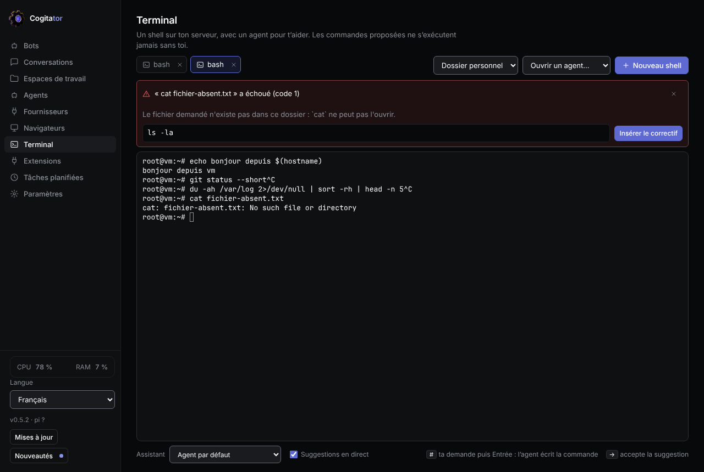

# Web terminal

Cogitator includes a terminal in the browser: a shell on the server, and your Cogitator agents running interactively in pi. An assistant agent helps you write commands. It never runs anything on its own.

## Availability and security

A terminal is a **full shell with the rights of the OS account that runs Cogitator**. That is why it is only available:

- in **protected mode** (`cogitator --auth-required`), for the signed-in owner. When MFA is enabled, the session must be approved;
- from the web interface. MCP tokens, OAuth connectors and the owner socket never get access;
- through a WebSocket that checks the exact `Origin` and re-checks the owner session every second. Signing out cuts open terminals.

In local mode (no login), the terminal page explains how to enable protected mode. To turn the terminal off on a server, start Cogitator with `COGITATOR_TERMINAL=0`.

Recommendations: run Cogitator under a dedicated OS account, not `root`. Enable MFA. Close sessions you no longer use.

## Sessions

- **New shell** opens a login shell (`$SHELL`, otherwise bash) in your home folder or in the selected workspace.
- **Open an agent…** starts one of your agents in pi's interactive interface, with its model, reasoning level, instructions, skills and MCP servers.
- Sessions keep running when you close the tab or lose the connection. Reopening replays the recent output (up to 256 KB). At most 8 sessions are open at once, and they stop when the server stops.
- On phones, a key bar provides Esc, Tab, Ctrl C and the arrow keys.

## Assistant

The assistant uses the model of the agent you choose in the status bar, or of the default agent. It calls that model directly, with the provider credentials already configured in Cogitator.

| Action | How |
| --- | --- |
| **Request to command** | Type `# find the largest log files`, then Enter. The agent writes the command on the line without running it. Read it, then press Enter. |
| **Live suggestions** | While you type, the end of the command appears in grey. Press **→** to accept it. You can turn this off in the status bar. It uses tokens on each pause. |
| **Explain an error** | When a command fails (bash), a banner offers **Explain**. The agent gives the cause and, when it can, a fix that you can insert into the line. |

The assistant receives the command line and the last visible lines of the terminal. Do not display secrets in a terminal while you ask it for help. In agent sessions, the assistant is off: pi has its own interface.

For bash, Cogitator starts the shell with a small rcfile in `<COGITATOR_HOME>/terminal/bashrc`. It loads your usual configuration (`/etc/profile`, `~/.bash_profile` or `~/.profile`), then adds the exit status to the prompt (OSC 133). Other shells work normally, without automatic error detection.

## Requirements

The pseudo-terminal uses `@lydell/node-pty`, an optional dependency with prebuilt binaries for Linux, macOS and Windows (x64 and arm64), so nothing is compiled during installation. If it is missing, the page says so. Reinstall Cogitator to fix that.

Behind Caddy, the `reverse_proxy` already forwards WebSockets. No extra configuration is needed.
